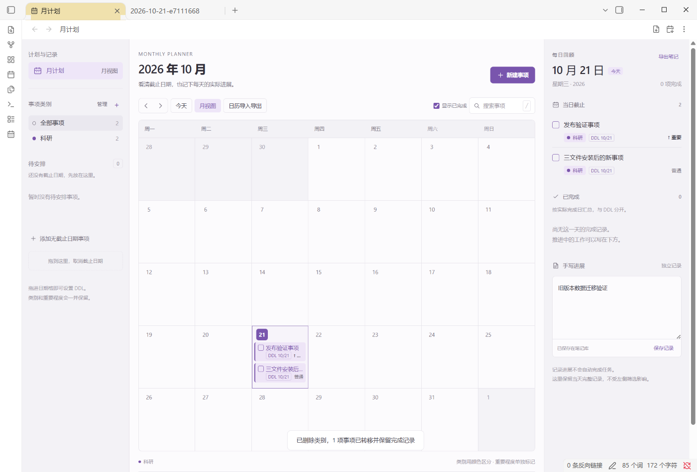

# Month Planner 月计划

A free, offline monthly deadline planner for Obsidian, with custom category colors, an undated backlog, daily completion history, and handwritten progress notes.

面向个人事务的月计划。月历只显示截止事项，无截止日期事项放在侧栏。每日实际完成记录和手写进展放在日期详情中。



## Installation status

This repository contains the first distribution prepared for community review. It is not yet listed in Obsidian's Community Plugins browser. A GitHub release is not the same as acceptance into the community directory.

### Install the beta on iPhone, iPad, or desktop

1. In Obsidian, open **Settings > Community plugins**, install and enable **BRAT**.
2. Open BRAT settings and choose **Add beta plugin**.
3. Enter `Muel-Cassini/obsidian-month-planner` and add the plugin.
4. Enable **Month Planner** under Community plugins.
5. Run **Month Planner: 打开月计划** from the command palette.

BRAT distributes the plugin code. It does not transfer your tasks or notes between devices. For data synchronization, include `.obsidian/plugins/month-planner/data.json` in your vault's synchronization settings.

### Manual installation

Download `main.js`, `manifest.json`, and `styles.css` from the same release. Place them inside `<vault>/.obsidian/plugins/month-planner/`, reload Obsidian, and enable Month Planner. The interface is embedded in `main.js`; a separate `ui.html` is not required.

## 功能

- 月历显示 DDL，侧栏保存暂时没有截止日期的事项。
- 自定义类别的名称和颜色。事项与 DDL 标签使用对应类别颜色，重要程度单独显示。
- 添加、编辑和删除类别。有事项的类别删除前需选择接收类别，原有事项、截止日期和完成记录保留。至少保留一个类别。
- 新建、编辑、完成、撤销完成和改期。拖动是可选操作，也可以打开事项直接修改日期。
- 按实际完成日期查看记录，手写当天进展，导出 Markdown 回顾。
- 选择事项手动导出 `.ics`，或预览并选择日历文件中的事件导入。
- 相同日历 UID 再次导入时更新已有事项，保留类别、重要程度和完成状态。
- 跟随 Obsidian 深浅主题，使用窄屏布局。

## Calendar exchange

Calendar exchange is manual. There is no Apple account connection or automatic background synchronization with Apple Calendar.

Deadlines export as all-day events. Completed tasks, undated tasks, and handwritten progress are excluded. Imported timed events become date-only deadlines. Recurring events, exceptions, and cancelled events are reported rather than expanded. Review the previewed date when changing time zones.

Apple Calendar colors belong to calendars. To use category colors there, import the separate category files into separately colored calendars. Do not import both `all.ics` and the category files for the same selection.

The plugin uses UID matching on import. Repeated file imports into Apple Calendar, iCloud display, and iOS file handling still require device testing. Deleting a category or task here does not remove events already imported into Apple Calendar.

## Data and synchronization

Tasks, category definitions, completion dates, and handwritten progress are stored in `.obsidian/plugins/month-planner/data.json`. `data.previous.json` stores the state before the last save. Back up these files before changing devices or synchronization settings.

Generated calendar files live under `月计划/日历导出/`. Selected manual exports live under `月计划/手动导出/`. Markdown review snapshots live under `月计划/回顾导出/`. Editing these snapshots does not update planner tasks.

Synchronize before editing on a different device and after finishing edits. This version stores the planner as one JSON file; it does not merge concurrent offline edits made on multiple devices. Syncing Markdown files alone does not transfer planner data.

## Compatibility and verification

- Minimum declared Obsidian version: 1.13.7, the desktop version used for baseline runtime validation.
- The manifest allows mobile loading and the interface includes a narrow layout. No iPhone or iPad hardware validation has been completed. Mobile users should try a test vault before using important data.
- The development version passed 11 desktop runtime checks, 16 category-deletion checks, and 7 iCalendar tests. The community package passed 12 additional runtime checks in Obsidian 1.14.4, using only the three official release assets in a separate desktop vault. See [verification evidence](docs/verification.json). These results do not establish iOS compatibility or resolve concurrent synchronization conflicts.
- The interface is currently in Chinese.

## Privacy and disclosures

- No account, payment, or subscription is required by this plugin.
- No analytics, telemetry, advertisements, or network requests are made by this plugin.
- It reads and writes only within the current vault. It does not read Apple accounts or other vaults.
- BRAT, GitHub, vault synchronization tools, and calendar applications are separate services with their own permissions and policies.

## Build from source

Requires Node.js 22 or later. There are no npm dependencies to install.

```sh
npm run build
npm test
npm run check
```

`src/ui-template.html` is an offline interface template. `build.mjs` removes demo storage and fixture data, injects the Obsidian message bridge, and embeds the resulting interface and calendar module into `main.js`. It also generates an optional local `ui.html` preview. Releases need only `main.js`, `manifest.json`, and `styles.css`.

Keep the plugin ID and folder name `month-planner` when upgrading so that existing data remains available. Do not include `data.json`, test vaults, app profiles, or personal notes in a public repository or release.

## License

MIT, copyright 2026 Muel-Cassini. See [LICENSE](LICENSE).
